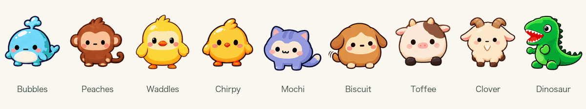
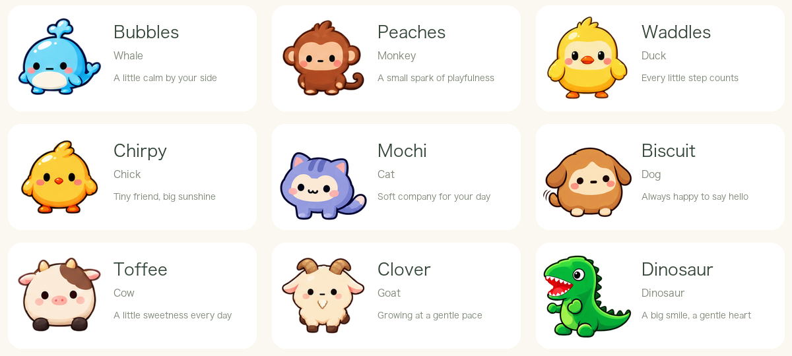
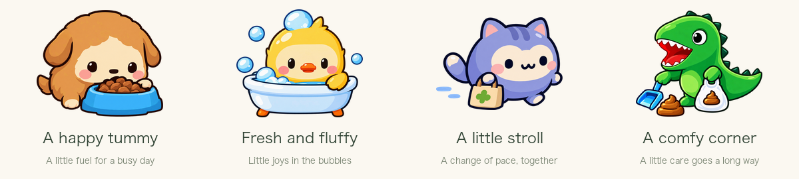
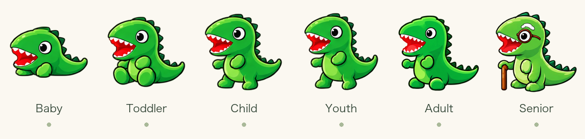

<p align="center"><a href="README.md">简体中文</a> · <strong>English</strong></p>

<p align="center">
  
</p>

<h1 align="center">DSH Digital Pet</h1>

<p align="center"><strong>While you work, they keep you company.</strong></p>

<p align="center">
  9 little companions · 6 life stages · Blinks and waves · Everyday care · Six months together
</p>

<p align="center">
  <a href="#adopt-your-first-companion">Adopt a companion</a> ·
  <a href="#meet-your-little-companions">Meet the pets</a> ·
  <a href="docs/DEVELOPMENT.md">Developer guide (Chinese)</a> ·
  <a href="LICENSE">MIT License</a>
</p>

---

Writing code, organizing requirements, waiting for a task to finish—every workday has its quiet little moments.

**DSH Digital Pet** is a companion-pet plugin that lives inside your **DeepSeek Harness workspace**. A small friend waits in a corner of the interface. Move your mouse closer, and it blinks, waves, and says hello in its own little way. Between tasks, give it a pat, serve a meal, or take it out for a stroll.

A little something to look forward to, every day.

## A little hello goes a long way



<sub>This GIF uses the plugin's actual animation frames for easy viewing on GitHub. In the plugin, animation plays only while you hover; moving away stops it and restores the first frame.</sub>

- **Say hello.** Nine species and six life stages bring you 54 frame-animation sets, with moving eyes, paws, wings, and feet.
- **Give a little pat.** Click your pet to send a small floating heart.
- **Find a comfy spot.** Drag it around the workspace, adjust its size, or hide it when you need to focus.
- **Set your own rhythm.** Configure its sleep schedule and quiet mode. System reduced-motion settings are respected, too.
- **Chinese and English.** Switch the UI language at the bottom of the pet settings page (Chinese by default); it applies immediately.

## Meet your little companions



**Bubbles** the whale, **Peaches** the monkey, **Waddles** the duck, **Chirpy** the chick, **Mochi** the cat, **Biscuit** the dog, **Toffee** the cow, **Clover** the goat, and **Dinosaur**, our friendly little dino.

Pick the one that makes you smile, then give it a nickname of your own. Each local profile can raise one living pet at a time—a little favorite, just for you.

## Turn a short break into a small ritual



| A little ritual | What happens |
| --- | --- |
| Serve a meal | Stock up on food and treats, then watch your friend enjoy a bite. |
| Run a bath | Take care of cleanliness and get your little companion fresh and comfy. |
| Go for a stroll | Change the mood and share a little time together. |
| Tidy up | Clean up the poop and keep its little space comfortable. |

Your pet gives small hints when it needs care. Click the paw button to open its care menu. Hunger, mood, cleanliness, food inventory, and growth records are available in settings.

**Eligible token usage** from your normal DeepSeek Harness activity can earn in-game coins for pet food. Pet care and everyday interactions **do not make additional model calls**, and the plugin does not read your chat text.

<details>
<summary>How do coins work?</summary>

By default, **1,000,000 eligible tokens earn 1 coin**, with a daily cap of 100 coins. The exchange rate and daily cap can be configured. The Host records and deduplicates usage; check the coin-details panel for your progress.

Your first adoption comes with a welcome gift. Free relief food is also available when inventory and cooldown conditions are met.

</details>

## It's okay to be busy

Some days are for deadlines, travel, or simply closing your laptop and getting some rest.

The plugin includes **offline protection and boarding care**. Longer absences trigger automatic care, and you can also enable boarding yourself. An occasional missed meal will not end your pet's life early. Water is replenished automatically, and free relief food is available when supplies run low.

Come back when you're ready. A little hello is enough.

## Grow together, and keep the memories



From a tiny bundle to a lively youngster, and eventually an old friend with glasses—its appearance and little gestures change as it grows.

Each pet has a lifespan of **six calendar months**, and it continues growing while in boarding care. When that journey ends, your time together is recorded in the **memory album**. You can adopt again afterward, keeping your coins and inventory.

We hope you'll remember the little friend in the corner of your workspace, waving just for you.

## Adopt your first companion

You need an installed, working **DeepSeek Harness**. This project is a Harness plugin; the pet appears inside the application's interface.

Run these commands in your terminal:

```bash
git clone https://github.com/openLabBean/dsh-digital-pet.git
cd dsh-digital-pet

# Replace desktop with the profile you actually use
dsh plugin --profile desktop add "$PWD"
```

Reload the corresponding Harness client, open **Settings → Digital Pet** (shown as **设置 → 电子宠物** in the current Chinese interface), choose a pet, and give it a name.

<details>
<summary>A few things to try when you first meet</summary>

1. Drag your pet to a spot you like.
2. Hover over it and see how it says hello.
3. Give it a click to send a little heart.
4. Click the paw button to feed it or go for a stroll. Some actions depend on its status or cooldowns.
5. Adjust its size, sleep schedule, and quiet mode in settings, and find a rhythm that suits you both.

</details>

## Help this little project grow

Bring an idea for a new pet, a tiny gesture you'd love to see, or a problem you ran into while using the plugin.

- [Share an issue or an idea](https://github.com/openLabBean/dsh-digital-pet/issues)
- [Read the developer, API, and implementation guide (Chinese)](docs/DEVELOPMENT.md)
- [Explore the growth and care balance report (Chinese)](docs/balance-report.md)
- [Read the MIT License](LICENSE)

Saves are stored separately for each local profile. Cross-device sync is not available in the current version. See the developer guide for more installation, configuration, and development details.

---

<p align="center"><strong>A little friend for everyone putting care into their work.</strong></p>

<sub>The hero is a promotional illustration based on the nine existing pet characters. The pet cards, growth image, care collage, and animation GIF use actual plugin artwork. This page translates the documentation; the plugin interface is currently in Chinese.</sub>
