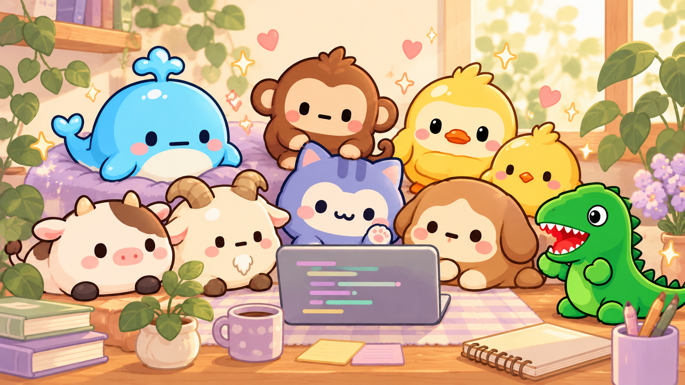
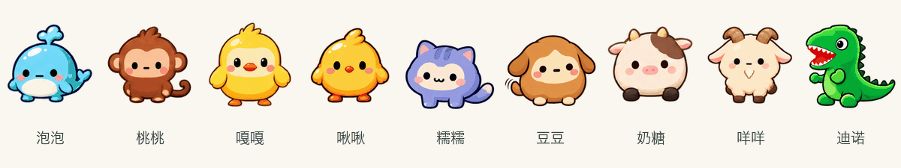
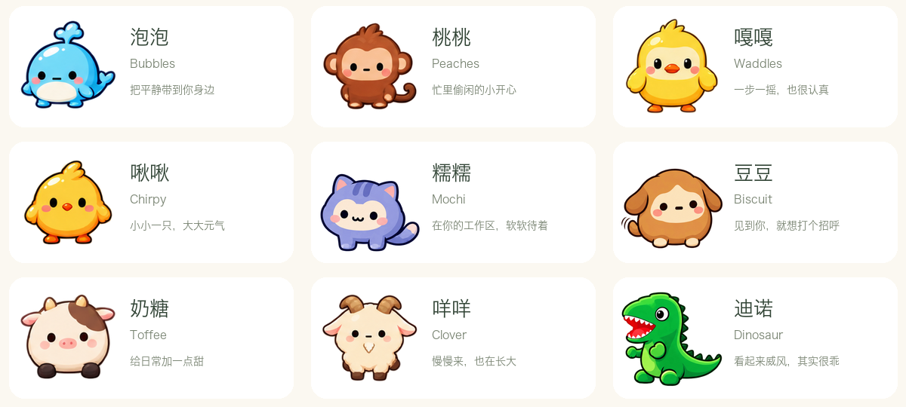
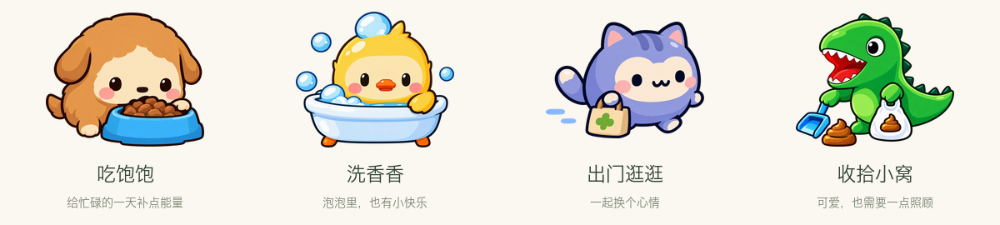
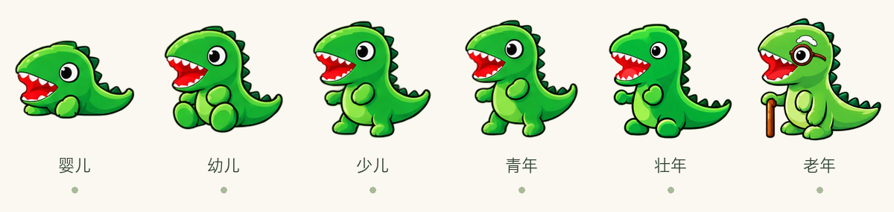

<p align="center">
  
</p>

<h1 align="center">DSH Digital Pet · 电子宠物</h1>

<p align="center"><strong>你认真工作，它认真陪你。</strong></p>

<p align="center">
  9 位小伙伴 · 6 段成长 · 眨眼招手 · 日常照护 · 六个月的陪伴
</p>

<p align="center">
  <a href="#领养你的第一位小伙伴">开始领养</a> ·
  <a href="#先认识一下它们">认识它们</a> ·
  <a href="docs/DEVELOPMENT.md">开发文档</a> ·
  <a href="LICENSE">MIT License</a>
</p>

---

写代码、整理需求、等一个任务跑完……工作时，总有一些安静的空隙。

**DSH Digital Pet** 是一个住在 **DeepSeek Harness 工作区**里的电子宠物插件。它会待在界面的一角；你把鼠标移过去，它眨眨眼、挥挥手，认真地跟你打个招呼。忙完一小段，摸摸它，喂顿饭，或者一起出门逛逛。

让一天天的工作，多一点值得惦记的小事。

## 鼠标靠近，快乐就有了回应



<sub>GIF 使用插件现有逐帧素材制作，便于在 GitHub 上直接观看。实际插件仅在鼠标悬停时播放，移开即停止并恢复首帧。</sub>

- **打个招呼。** 9 种宠物、6 个成长阶段，共 54 套逐帧动作，眼睛和小手小脚都会动。
- **摸摸脑袋。** 轻点宠物，会飘出一颗小爱心。
- **找个舒服的位置。** 在工作区里拖动它，调整大小；需要专注时，也可以暂时隐藏。
- **按自己的节奏相处。** 支持作息设置、免打扰，以及系统的减弱动态效果。

## 先认识一下它们



鲸鱼 **泡泡 Bubbles**、猴子 **桃桃 Peaches**、鸭子 **嘎嘎 Waddles**、小鸡 **啾啾 Chirpy**、猫猫 **糯糯 Mochi**、狗狗 **豆豆 Biscuit**、牛牛 **奶糖 Toffee**、山羊 **咩咩 Clover**，还有恐龙 **迪诺 Dinosaur**。

选一位合眼缘的小伙伴，再给它起一个属于你们的昵称。每个本地 profile 同时养一只，把这份偏爱留给它。

## 把照顾，变成工作间隙的小仪式



| 小小的日常 | 会发生什么 |
| --- | --- |
| 喂一顿饭 | 买口粮、备零食，看看它吃饭的样子。 |
| 洗个澡 | 照顾清洁，给小家伙洗得香香的。 |
| 一起逛街 | 换个心情，也给陪伴留一点共同经历。 |
| 收拾小窝 | 清掉便便，让它舒服地待在你身边。 |

需要照顾时，它会给出小提示。点击爪印就能打开照护菜单；饱食、心情、清洁、食品背包和成长记录，都能在设置页里查看。

你平时使用 DeepSeek Harness 产生的**有效 Token 用量**，可以兑换成游戏内金币，用来给它准备口粮。养宠和日常互动本身**不会额外发起模型调用**，也不读取聊天正文。

<details>
<summary>金币怎么算？</summary>

默认每 **1,000,000 个有效 Token 兑换 1 金币**，每日最多 100 金币；兑换比例与每日上限可在插件配置中调整。有效用量由 Host 记账、去重，具体进度可在「金币明细」里查看。

刚开始会有首次领养赠礼；符合库存与冷却条件时，也可以领取免费救济口粮。

</details>

## 忙的时候，也可以放心去忙

总有赶进度、出差，或者想关掉电脑休息的日子。

插件提供**离线保护与托管照护**：长时间离线会进入自动照护，也可以主动开启托管。它不会因为你偶尔忘了喂食而提前离开。饮水会自动补给，缺少口粮时还有免费救济入口。

回来之后，再给它一个招呼就好。

## 慢慢长大，留下属于你们的故事



从小小一团，到活泼的青年，再到戴上眼镜的老伙伴——形象和小动作，会随着年龄一起变化。

每位宠物拥有 **六个自然月**的生命周期，托管期间也会继续长大。旅程结束后，这段陪伴会留在**纪念册**里；之后可以再次领养，金币和背包也会保留。

希望你记住的，是它曾经在工作区的角落，认真朝你挥过的小手。

## 领养你的第一位小伙伴

需要已安装并可运行的 **DeepSeek Harness**。这个项目是 Harness 插件，宠物显示在它的应用界面内。

在终端中执行：

```bash
git clone https://github.com/openLabBean/dsh-digital-pet.git
cd dsh-digital-pet

# desktop 换成你实际使用的 profile 名称
dsh plugin --profile desktop add "$PWD"
```

重新加载对应的 Harness 客户端，打开 **设置 → 电子宠物**，选一只、起个名字，就可以开始相处了。

<details>
<summary>第一次见面，可以做这几件事</summary>

1. 把它拖到一个顺眼的位置。
2. 鼠标悬停，看看它怎么跟你打招呼。
3. 轻点一下，送它一颗爱心。
4. 点击爪印，喂顿饭或一起逛逛；部分操作会受状态或冷却时间限制。
5. 在设置页调整大小、作息和免打扰，找到你们舒服的相处方式。

</details>

## 也欢迎，一起把它养得更好

你可以带着新宠物的灵感、小动作的点子，或者使用中遇到的问题，来参与这个小项目。

- [提交问题或想法](https://github.com/openLabBean/dsh-digital-pet/issues)
- [阅读开发、接口与实现说明](docs/DEVELOPMENT.md)
- [查看成长与照护的平衡报告](docs/balance-report.md)
- [了解 MIT 许可](LICENSE)

存档按本地 profile 分开保存，当前版本不做跨设备同步。更多安装、配置与开发细节，请查看开发文档。

---

<p align="center"><strong>愿每一个认真工作的你，都有一位认真陪伴的小伙伴。</strong></p>

<sub>顶部图片为使用现有九位宠物形象绘制的宣传插画；宠物名片、成长图、照护图和动作 GIF 使用插件实际素材制作。</sub>
